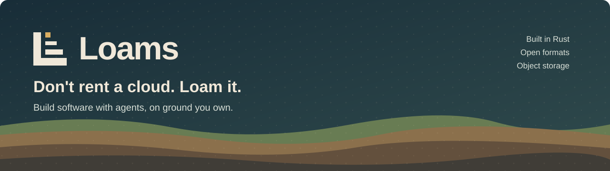

# Loams Postgres on RustFS (development)

This directory was the `neon` stack under `deploy/` until NF1 Task 1b (D823). The compose project is
still named `loams-neon`, because Docker names users' volumes after it.

The stack from the Neon + WeSQL spike ([§23](../../docs/design/23-neon-and-wesql.md)). It runs
Neon's storage (storage broker, one pageserver, one safekeeper) on a RustFS bucket and starts
Postgres computes against an explicit tenant and timeline. Loams does not link Neon; in the
design, Loams plays the part of the control plane that the commands below play by hand.

It is derived from `neondatabase/neon` `docker-compose/` (Apache-2.0). `compute/config.json` is
Neon's compute spec with one safekeeper; `compute/start.sh` replaces Neon's `compute.sh`, because
the `compute-node` image has no `curl`, `jq` or `nc`, and tenants and timelines are created by
the caller.

Not a production layout: no storage controller, no Neon proxy, no TLS, default credentials,
`fsync = off` in the compute spec, and the safekeeper keeps WAL in its container filesystem.
Images are pinned by digest (PG2 Task 2): Neon's last public build, 2025-08-26, git
`77e22e4b`. The fork `ostrium-labs/loams-postgres` publishes no images yet (PG2 ruling R2.1);
`NEON_IMAGE` and `COMPUTE_IMAGE` override the pins.

| Image | Digest (multi-arch index) | amd64 manifest |
|---|---|---|
| `ghcr.io/neondatabase/neon` | `sha256:7a4f124917bb929964b2d696d710f19584f80bb9bd51b2af4a6e2425434c761f` | `sha256:ead56a7b33925ca4df9f1ee0d29f55fa25e165a3fee6a4f19055050c68e8cad0` |
| `ghcr.io/neondatabase/compute-node-v17` | `sha256:13ab146d3e7bbabb25a8532f315ac443e7512351d1ede0bab586def5c70e26c3` | `sha256:9b86e3ecb2267fbdeb0fd2478db0e662959ccdfa4526efa4a558410a93c6c46f` |

Postgres is 17 (PG2 Task 0 ruling 7).

Resources in the spike: about 5 GB (`neon`) plus 1.3 GB (`compute-node-v17`) of images; storage
services under 0.5 GB of RAM together.

## Mirror

NF1 Task 1 copied Neon's last public build (git `77e22e4b`, Neon build `8464`, 2025-08-26)
to `ghcr.io/ostrium-labs/neon-archive/`, registry to registry with unchanged digests, so it
survives Neon deleting its packages. These are Neon's binaries under Neon's names (D822), not
Loams Postgres. The packages are **private** (Q715) until the owner has read the audit below.

| Source (Neon) | Source digest | Mirror | Mirror digest | Audit |
|---|---|---|---|---|
| `ghcr.io/neondatabase/neon` | `sha256:7a4f124917bb929964b2d696d710f19584f80bb9bd51b2af4a6e2425434c761f` | `ghcr.io/ostrium-labs/neon-archive/neon:mirror-77e22e4b` | `sha256:7a4f124917bb929964b2d696d710f19584f80bb9bd51b2af4a6e2425434c761f` | CDDL, private source ([audit](../pins/audit/sha256-7a4f124917bb929964b2d696d710f19584f80bb9bd51b2af4a6e2425434c761f.json)) |
| `ghcr.io/neondatabase/compute-node-v17` | `sha256:13ab146d3e7bbabb25a8532f315ac443e7512351d1ede0bab586def5c70e26c3` | `ghcr.io/ostrium-labs/neon-archive/compute-node-v17:mirror-77e22e4b` | `sha256:13ab146d3e7bbabb25a8532f315ac443e7512351d1ede0bab586def5c70e26c3` | CDDL ([audit](../pins/audit/sha256-13ab146d3e7bbabb25a8532f315ac443e7512351d1ede0bab586def5c70e26c3.json)) |
| `ghcr.io/neondatabase/compute-node-v16` | `sha256:b3e151661bd2ee11eb2843c8926001966cb23969227e9673c5f42fc3fbe14249` | `ghcr.io/ostrium-labs/neon-archive/compute-node-v16:mirror-77e22e4b` | `sha256:b3e151661bd2ee11eb2843c8926001966cb23969227e9673c5f42fc3fbe14249` | CDDL ([audit](../pins/audit/sha256-b3e151661bd2ee11eb2843c8926001966cb23969227e9673c5f42fc3fbe14249.json)) |
| `ghcr.io/neondatabase/build-tools` | `sha256:bd1fe230b33aab4d7c2b336311aa8f96733a32a4eed4d61eecfb1c6b6d8cf6e3` | `ghcr.io/ostrium-labs/neon-archive/build-tools:mirror-77e22e4b` | `sha256:bd1fe230b33aab4d7c2b336311aa8f96733a32a4eed4d61eecfb1c6b6d8cf6e3` | clean ([audit](../pins/audit/sha256-bd1fe230b33aab4d7c2b336311aa8f96733a32a4eed4d61eecfb1c6b6d8cf6e3.json)) |

`compute-node-v16` is the tag `8464` and `build-tools` the tag
`d4a4001a8381b2f2b33462941d4382ad5c71f4a39c12a4c66cec0397abd8d160-bookworm`; both were matched to
`77e22e4b` through the images' SLSA provenance (`GIT_VERSION`, and the `build-tools` material of
the `neon` build). Each index keeps BuildKit's attestation manifests (SPDX SBOM and SLSA
provenance), copied byte for byte with the images.

Audit (`scripts/nf1/audit-image.sh`, 2026-10-10/11; every platform):

- **`neon`: CDDL and a private source.** The image has ten Rust binaries with `.dep-v0` per
  platform, plus `neon.so` for v14 to v17. Nine of the binaries (`pageserver`, `safekeeper`,
  `proxy`, `pg_sni_router`, `storage_broker`, `storage_controller`, `storage_scrubber`, `pagectl`
  and `neon_local`; all but `endpoint_storage`) link `inferno` 0.11.21 and 0.12.0 (CDDL-1.0,
  through `pprof`). `proxy` and `pg_sni_router` also link `subzero-core` 3.0.1 from git: Neon's
  `Dockerfile` replaces the public path stub with the private `neondatabase/subzero` (rev
  `39626461`) when its CI supplies `SUBZERO_ACCESS_TOKEN`. 40 findings in all.
- **`compute-node-v17` and `compute-node-v16`: CDDL.** `local_proxy` links `inferno` 0.11.21 and
  0.12.0 (CDDL-1.0, through `pprof`), on amd64 and arm64. Neon builds the compute image with plain
  `cargo build`, so none of its 14 Rust binaries per platform (`compute_ctl`, `fast_import`,
  `local_proxy` and the Rust extensions, such as `neon.so`, `pg_graphql.so`, `pg_session_jwt.so` and
  `rag.so`) has a `.dep-v0` section. Their lists come from the Cargo source paths left in each
  binary (`"evidence": "strings"`), which is a lower bound. No private `subzero` source. The git
  sources are `framed-websockets`, `rust-postgres` (both forked by us) and `tiktoken-rs`.
- **`build-tools`: clean.** It has 26 binaries with package data (the `cargo auditable install`
  tools, `rustup`, and the Rust parts of the Python wheels), and no CDDL or private source.
  It is a build image and is never deployed.

So `neon`, `compute-node-v17` and `compute-node-v16` stay private: Q715's default, "a
package with a finding stays private". Making `build-tools` public is the owner's decision (step 5).
Our own builds drop `inferno` (Task 7, `pprof` without `flamegraph`).

Runbook (registry to registry; nothing is pulled into a local image store):

1. Log in with a token that has `write:packages`, into a private auth file:
   `skopeo login --authfile "$REGISTRY_AUTH_FILE" -u <user> --password-stdin ghcr.io`.
2. Copy and verify each image with `scripts/nf1/mirror-images.sh <src>@sha256:<digest> ghcr.io/ostrium-labs/neon-archive/<name> mirror-77e22e4b`; it fails unless the index and every child manifest are byte-identical to the source.
3. Run `scripts/nf1/audit-image.sh ghcr.io/ostrium-labs/neon-archive/<name>@sha256:<digest> > deploy/pins/audit/sha256-<hex>.json` on each mirrored index (exit 3 is a finding: CDDL or a private source).
4. Record both digests and the findings in the table above and in the NF1 plan's rulings; check that each package is still private (`gh api orgs/ostrium-labs/packages/container/neon-archive%2F<name> -q .visibility`).
5. Only after the audit, and only by the owner: make a package public. A package with a finding stays private.

## Run

With Docker, or Podman plus `DOCKER_HOST=unix:///run/user/$UID/podman/podman.sock`:

```sh
docker compose up -d rustfs create-bucket storage_broker pageserver safekeeper1

# Create a tenant and its first timeline through the pageserver API. The timeline's
# Postgres version must match the compute image (compute-node-v17).
export TENANT_ID=$(openssl rand -hex 16) TIMELINE_ID=$(openssl rand -hex 16)
curl -X PUT -H 'Content-Type: application/json' \
  -d '{"mode":"AttachedSingle","generation":1,"tenant_conf":{}}' \
  localhost:9898/v1/tenant/$TENANT_ID/location_config
curl -X POST -H 'Content-Type: application/json' \
  -d "{\"new_timeline_id\":\"$TIMELINE_ID\",\"pg_version\":17}" \
  localhost:9898/v1/tenant/$TENANT_ID/timeline/

docker compose up -d compute1
# The compute takes a few seconds to accept connections.
until pg_isready -q -h 127.0.0.1 -p 55433; do sleep 1; done
PGPASSWORD=cloud_admin psql -h 127.0.0.1 -p 55433 -U cloud_admin postgres
```

## Branch

A branch is a new timeline whose ancestor is an existing one. It takes tens of milliseconds and
copies no data:

```sh
export BRANCH_TIMELINE_ID=$(openssl rand -hex 16)
curl -X POST -H 'Content-Type: application/json' \
  -d "{\"new_timeline_id\":\"$BRANCH_TIMELINE_ID\",\"ancestor_timeline_id\":\"$TIMELINE_ID\"}" \
  localhost:9898/v1/tenant/$TENANT_ID/timeline/
docker compose --profile branch up -d compute2
until pg_isready -q -h 127.0.0.1 -p 55434; do sleep 1; done
PGPASSWORD=cloud_admin psql -h 127.0.0.1 -p 55434 -U cloud_admin postgres
```

Add `"ancestor_start_lsn": "<lsn>"` to branch from a point in the past.

## Stop

```sh
docker compose --profile branch down
```

To delete the data as well (destructive: removes the RustFS bucket and every tenant):

```sh
docker compose --profile branch down -v
```
