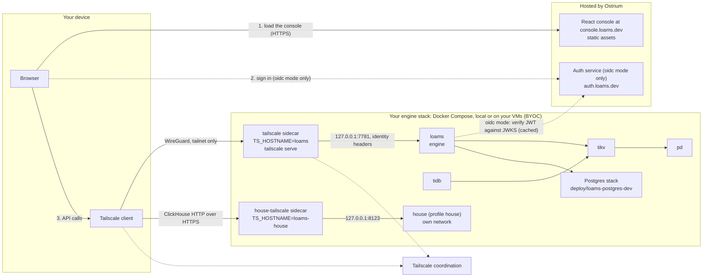

# Running Loams 0.1.0: run the whole stack yourself

Status: **0.1.0**, the first release (after v0.1.0-preview.1 on 2026-10-12 and
v0.1.0-preview.2 on 2026-10-15). What changed since preview.2 is in
[What is new in 0.1.0](#what-is-new-in-010) and the [changelog](../../CHANGELOG.md).
Everything listed as **Available** or **Experimental** in the
[feature status table](#feature-status) ships in this release.

0.x means APIs, on-disk formats and flags may change between minor versions. Upgrades are
supported: `loams upgrade` moves a stack from one release to the next and keeps its data (see
[upgrades](upgrades.md)). **Experimental** features work and are tested in CI, but may change
more, or be reworked, before they settle. Parts of the security model are not hardened yet (see
[Security model](#security-model)).

0.1.0 ships one path: **your own Tailscale tailnet plus our hosted console at
`https://console.loams.dev`**. You run the Loams stack; we host the console and, for the
optional `oidc` mode, the auth service.

| Piece | Who runs it | Where |
|---|---|---|
| The engine stack: `loams`, TiDB on TiKV and PD, the House, the Postgres stack | **You** | Docker Compose on your laptop, or on your own VMs (BYOC) with `deploy/release/byoc/install.sh` over SSH |
| The private network between your devices and the stack | **You** | Your own Tailscale tailnet |
| The React console (static files) | Ostrium | `https://console.loams.dev` |
| The auth service (OIDC issuer), only for `oidc` mode | Ostrium | `https://auth.loams.dev` |

The engine is never exposed on the public internet. Your browser reaches it over the tailnet,
through the Tailscale client on your own device.

**Coming soon, not in this release:** the console on your own Vercel or Cloudflare project,
self-service OIDC clients (`auth.loams.dev/register`), Headscale networks, one-click OAuth
deploy, and the House wired to the engine (and so to the console's House page).

## What is new in 0.1.0

- **Upgrades that keep data.** `loams upgrade check|--to|rollback|status|snapshots` upgrades a
  self-hosted compose stack one release at a time. It snapshots every store first, runs the
  release's migrations in a one-shot `migrate` service, restarts in order and verifies, and
  rolls back on a failure. See [upgrades](upgrades.md).
- **Loams Studio** (experimental): coding agents in threads, each with its own git worktree,
  with diff review, git actions, checkpoints, terminals, previews, supervised approvals and
  parallel run groups, through `loams-agentd`'s Connect API. Loams Desktop opens in Studio; in
  the browser it runs against a remote daemon behind the instance feature `studio`.
- **Git push and fetch to the bucket** (experimental): `git-remote-loams` ships next to `loams`
  in the Linux packages, the macOS tarballs and the Windows zip.
- **Loams House** (experimental) is wired to the engine over TLS on a private network
  (`LOAMS_HOUSE_ENDPOINT`), writes lake tables (`INSERT`, `INSERT … SELECT`,
  `CREATE TABLE … AS SELECT`, `TRUNCATE`) and compacts them (`OPTIMIZE TABLE`).
- **Loams Postgres's control plane** in the stack: `--profile postgres-control` runs
  `pg-control` and a separate compute runner, `pg-runner`.
- **Loams Live** on the engine's main port, over the tailnet: many apps per engine, per-app and
  per-table authorization, end users from any OIDC provider, sessions that follow who is signed
  in, TLS on the main port and several nodes serving one store.
- **`loams-agentd` supervises new threads by default**, on your own machine too: existing local
  users will see approval prompts for threads that used to run unattended (see the
  [changelog](../../CHANGELOG.md)).

## Desktop and CLI

Download from the [GitHub release](https://github.com/ostrium-labs/loams/releases) and check
the files against `DESKTOP-SHA256SUMS` (desktop) or the release checksums (CLI).

| Platform | Loams Desktop | `loams` CLI |
|---|---|---|
| Linux x64, arm64 | `.deb`, `.rpm`, `.pacman`, `.AppImage` | `.deb`, `.rpm`, `.pkg.tar.zst` |
| macOS arm64, x64 | `.dmg`, `.zip` | `.tar.gz` |
| Windows x64 | NSIS installer, `.zip` | `.zip` |

Builds that are not signed by a trusted certificate (the release notes say which):

- **macOS:** ad-hoc signed, not notarized. After installing, run
  `xattr -dr com.apple.quarantine /Applications/Loams.app` (or the CLI binary) once.
- **Windows:** unsigned. SmartScreen shows "Windows protected your PC": choose
  **More info → Run anyway**.

The server stack stays Linux containers: on macOS and Windows run `deploy/release` with Docker
Desktop. The patched TiDB image is amd64-only and runs emulated on Apple silicon.

## SDKs

The seven supported SDKs are released from this tag by one workflow (`sdk-release.yml`).
<!-- verify after publish: each registry below serves 0.1.0 -->

| SDK | Install | Version |
|---|---|---|
| TypeScript | `npm i @loams/client` (and `@loams/live`) | `0.1.0` |
| Python | `pip install loams` | `0.1.0` |
| Rust | `cargo add loams` | `0.1.0` |
| C# | `dotnet add package Loams` | `0.1.0` |
| Go | `go get loams.dev/go@v0.1.0` (Go 1.25+) | `0.1.0` |
| Swift | SwiftPM: `https://github.com/ostrium-labs/loams`, from `0.1.0` | `0.1.0` |
| C++ | `loams-cpp-0.1.0.tar.gz` from the GitHub release (CMake `find_package(loams)`) | `0.1.0` |

Java, Kotlin, Ruby, PHP, Dart and Objective-C stay in the repository (coming soon).

## Architecture



1. The browser loads the console's static files from `console.loams.dev`. The console holds
   no data and no secrets.
2. In the default `tailscale` mode there is no separate sign-in: the console calls your
   engine and Tailscale tells the engine who you are. In `oidc` mode the console signs you
   in with Authorization Code + PKCE against the auth service; tokens live in memory only,
   never in `localStorage`.
3. The console calls your engine at `LOAMS_ENGINE_URL`, a tailnet URL such as
   `https://loams.<tailnet>.ts.net`. The request leaves your browser through your device's
   Tailscale client and reaches the stack's `tailscale` sidecar. Off the tailnet the URL does
   not resolve and nothing answers.
4. In `oidc` mode the engine verifies the token against the issuer's JWKS (fetched outbound,
   cached). The auth service never connects to your stack, and never sees your data.

## Feature status

**Available** means it ships in the 0.1.0 images and packages and is built and tested in CI; as with all of 0.x, APIs and formats may change between minor versions, with `loams upgrade` to move between them. **Experimental** ships too, but may change more before it settles. **In progress** and **Planned** do not ship in 0.1.0.

| Feature | What you get | Status |
|---|---|---|
| Collections | Documents with a schema, stored as Lance (vectors, columns) plus Tantivy (full text) under one manifest; upserts and deletes by id | Available |
| Hybrid retrieval | Vector kNN, BM25 and filters fused with RRF in one query; SQL table functions `vector_search`, `text_search` and `rrf` | Available |
| Native REST API | Namespaces, streams, collections, links, hybrid query and SQL | Available |
| Arrow Flight SQL | SQL and Arrow results for any language with an ADBC or Flight SQL driver | Available |
| Qdrant API | Qdrant REST and gRPC, tested with `qdrant-client` 1.15 and 1.19 | Available |
| Elasticsearch subset | Document APIs, `_bulk`, `_search` with the core Query DSL, `knn`, hybrid and RRF, tested with `elasticsearch-py` 8.19 | Available |
| Streams and links | Partitioned streams with a native produce and fetch API; links apply streams to targets exactly once | Available |
| Hot tier | HNSW vector artifacts and pinned text splits in RAM and NVMe, with delta indexes for fresh writes | Available |
| Pinned scans | Read a collection's pinned Lance version directly with pylance, Ray, Polars or PyTorch | Available |
| Cluster mode | `loams cluster` with roles, rendezvous placement, read forwarding and write backpressure | Available |
| TiKV metastore | The catalog, leases and timestamp oracle on TiKV (`--meta tikv://…`, cargo feature `tikv`) | Available |
| Loams Durable | An embedded Resonate server: durable promises and tasks on SQLite (cargo feature `durable`) | Available |
| Durable store on TiKV | Durable execution state on TiKV for clusters | In progress |
| Loams Live | A reactive document database: transactions, indexes, live queries and a TypeScript SDK, on an embedded store or on TiKV (`live-tikv`) | Available. Deploys, rollback, validators and online index changes through `LiveAdminService` on the main port, over the tailnet; many apps per engine, per-app and per-table authorization, end users from any OIDC provider; a deploy reaches every node at once |
| Loams Graph | `loams.graph.v1` on the main port, GQL on Grafeo (cargo feature `graph`) | Available. Writes reach the Loams log before they are acknowledged, with a fenced single owner per graph, snapshots in the bucket and crash recovery (GR1 Tasks 11 to 14), on Loams' Grafeo fork |
| Loams House | ClickHouse-compatible analytics on chDB in `loams-fabric`, with `loams.house.v1` proxied by the engine | Experimental. `--profile house` serves its ClickHouse HTTP interface on your tailnet through its own sidecar, with chDB access control, statement checks and sealed workers. With `LOAMS_HOUSE_ENDPOINT` the engine reaches it over TLS on a private network; lake tables take `INSERT` (every declared format, `VALUES`, `SELECT`), `CREATE TABLE … AS SELECT`, `TRUNCATE` and `OPTIMIZE TABLE` |
| Loams SQL | MySQL-compatible SQL on a patched TiDB (`v8.5.8-loams.1`) over TiKV | Available |
| Loams Postgres | A fork of Neon whose storage lives on the bucket; the compose stack runs its storage and computes | Available. The compose stack runs its storage and computes; `--profile postgres-control` adds `pg-control` and `pg-runner`, which provision computes and endpoints |
| Postgres and MySQL wire | SQL over the Postgres and MySQL wire protocols, over collections | Available |
| Streaming gRPC API | Idempotent produce and streaming subscribe over gRPC | Available |
| Web console | One console of cordis plugins on Connect, hosted at `console.loams.dev` and in Loams Desktop, with a Studio mode (on in Loams Desktop; in the browser behind the instance feature `studio`, which no Loams server sets yet; [Studio guides](../guides/studio/index.md)); sign-in from your tailnet login, a Loams account or an API key. Your own Vercel or Cloudflare deployment is coming soon | Available. Studio mode is experimental. Some pages still show demonstration data |
| Engine auth | Tailscale identity (default), OIDC (JWTs checked against the issuer's JWKS), hashed API keys, or loopback-only (`LOAMS_AUTH_MODE`) | Available |
| Loams Git | Git on the bucket: a WAL, ref log, checkpoints, O(1) forks and GC, and `loams.repos.v1`'s repository catalog (cargo feature `git`) | Experimental. `git-remote-loams` ships with the `loams` CLI packages and pushes and fetches straight to a bucket, and its first push creates a repository (`LOAMS_GIT_CREATE_ON_PUSH=1`; the URL names the namespace by its numeric id, see [packaging](packaging.md#git-push-and-fetch-to-the-bucket)); the repository service is not in the release images, so `RepoService` answers `feature_not_in_variant` |
| First-party connectors | Native source and sink connectors (Kafka family, Postgres CDC, object storage, key-value, search, brokers, cloud queues, HTTP APIs) on `loams-connector-sdk` | In progress. Not in the release images |
| Self-hosting with Docker Compose | The whole stack in `deploy/release/compose.yaml`, reachable only over your Tailscale tailnet, locally or on your VMs with `byoc/install.sh` over SSH | Available. Headscale is coming soon |
| Graph expansion | GraphRAG expansion of 1 to 2 hops from a retrieval query's hits: the `expand` stage of a search (REST and Connect), and the SQL table functions `graph_expand`, `graph_neighbors`, `graph_degree` and `graph_shortest_path` | Experimental. Runs on a Loams Graph (cargo feature `graph`, in the release `loams` image); the caller needs `reader` on each graph it touches (GR1 R24.12). The SDKs and the MCP `search` tool do not expose it yet (GR1 Task 36), and a UUID-keyed collection's neighbors come back without their documents |
| Iceberg analytics | Iceberg tables through a REST catalog, readable by DuckDB, Spark, Trino and ClickHouse | Planned |
| Kafka wire and OTLP | Kafka clients and OpenTelemetry logs ingest into streams | Planned |
| Authorization and tenancy | Roles, per-namespace authorization, tenant quotas and a namespace router | Planned |
| Native SDKs | TypeScript, Python, Go, Rust, C#, Swift and C++ clients with generated API bindings and shared runtime conformance fixtures, published as `0.1.0` (see [SDKs](#sdks)) | Available. Java, Kotlin, Ruby, PHP, Dart and Objective-C are in progress |
| MCP and analytics helpers | Agent tools and convenience integrations such as `to_arrow()` and `to_polars()` | Planned |
| Loams Functions | A CPU-time serverless runtime on workerd, wasmtime and gVisor, with a Rust Dapr-style API | Planned |
| Loams Jobs | Celery, BullMQ v6, PySpark (through Sail) and Flink SQL (through RisingWave) jobs run durably on Loams | Planned |
| Self-hosting with GitOps | A Helm chart, a Kubernetes operator and Argo CD layouts | Planned |

## What is in the stack

The compose file is [`deploy/release/compose.yaml`](../../deploy/release/compose.yaml), with
its settings in `deploy/release/.env.example`.

| Service | Image | Role |
|---|---|---|
| `pd` | PD | TiKV's placement driver |
| `tikv` | TiKV | Metadata, Live transactions, TiDB's storage |
| `tidb` | `ghcr.io/ostrium-labs/tidb:v8.5.8-loams.1` | Loams SQL (MySQL compatible) |
| `loams` | `ghcr.io/ostrium-labs/loams` | The engine, built with `live,live-tikv,durable,graph,tikv,pgwire,mysql-wire,stream-grpc` |
| `house` (profile `house`) | `ghcr.io/ostrium-labs/loams-fabric` | Loams House (the front, with `loams-house-worker` inside), on a network of its own and a private TLS link to the engine. Not started by default; the engine reaches it once `LOAMS_HOUSE_ENDPOINT` is set |
| `house-tailscale` (profile `house`) | `tailscale/tailscale` | The House's own door: joins the tailnet as `loams-house` and serves its ClickHouse HTTP interface there |
| Postgres stack | pinned in `deploy/pins/loams-postgres-images.toml` | Included from [`deploy/loams-postgres-dev`](../../deploy/loams-postgres-dev/README.md) |
| `console` (profile `console`, optional) | static console | A local copy of the console, for local trials; the supported console is the hosted one |
| `tailscale` | `tailscale/tailscale` | The stack's only door: joins the tailnet as `loams` and serves the engine there |
| `headscale` (profile `headscale`) | Headscale | Coming soon, unsupported in this release (see [the tailnet](#the-tailnet)) |

`ghcr.io/ostrium-labs/loams-agentd` (the agent daemon) is published too, and is optional.
Images are tagged `0.1.0`, `0.1` and `:latest`. The compose file pins `0.1.0` through
`LOAMS_VERSION`. The patched TiDB image
`ghcr.io/ostrium-labs/tidb:v8.5.8-loams.1` is public and amd64 only.

Only the `tailscale` service (and, with `--profile house`, `house-tailscale`) is reachable
from outside the compose network, and only over your tailnet. Nothing binds `0.0.0.0` on the
host by default.

## Quick start: fully local

You need Docker with the Compose plugin (v2.20.3 or later, for `include`), several GB of free
memory (TiKV, TiDB and the Postgres stack are the large ones), and the Tailscale client on the
machine whose browser you will use.

```sh
git clone https://github.com/ostrium-labs/loams.git
cd loams/deploy/release
cp .env.example .env
```

Edit `.env`:

- `TS_AUTHKEY`: an auth key from your Tailscale admin console (Settings, Keys). A tagged,
  non-ephemeral, single-use key is the right shape; see [the tailnet](#the-tailnet).
- `TS_HOSTNAME=loams`: the stack's name on the tailnet. Keep it unless you run two stacks.
- `LOAMS_AUTH_MODE`: `tailscale` by default, which needs nothing more. Set
  `LOAMS_TAILSCALE_ALLOWED_USERS` to narrow who is admitted. See [Auth modes](#auth-modes).

Then start it:

```sh
docker compose up -d
docker compose ps                                   # every service running
docker compose exec tailscale tailscale status      # the stack is on your tailnet
```

The engine's URL is `https://<TS_HOSTNAME>.<tailnet>.ts.net`, by default
`https://loams.<tailnet>.ts.net`.

Enable **MagicDNS** and **HTTPS certificates** for your tailnet (Tailscale admin console, DNS),
so the sidecar can serve `https://loams.<tailnet>.ts.net`. Open
[console.loams.dev](https://console.loams.dev) in a browser on a device that is on the same
tailnet, and enter that URL as your engine.

From the CLI or an SDK, set `LOAMS_AUTH_MODE=apikey`, create a key with `loams auth new-key`
and use the same tailnet URL.

To stop, `docker compose down`. Your data stays in the compose volumes; `docker compose
down -v` deletes it.

### Without a tailnet

For a laptop-only trial with nothing on any network, set `LOAMS_AUTH_MODE=off` and use the
optional local `console` service. `off` is accepted only for loopback clients: the engine
refuses every request that does not come from loopback, so this mode cannot be reached over
the tailnet. Do not use it on a shared machine.

### The bucket: a local directory or S3

`LOAMS_BUCKET` in `.env` is where the engine keeps its data. The default,
`file:///var/lib/loams/bucket`, is the `loams-data` volume. For an object store, set
`LOAMS_BUCKET` to `s3://<bucket>/<prefix>` (or `gs://...`, `az://...`) and put the store's
settings in `secrets/engine.env`, one `KEY=value` per line. The engine and the one-shot
`migrate` service both read that file. The engine reads them the way the backends' own
`from_env()` do: `AWS_*` for S3, `GOOGLE_*` for GCS and `AZURE_*` for Azure. At startup it logs
the bucket, endpoint, region and where its credentials come from, never their values.

The store needs conditional writes (`If-None-Match` and `If-Match` on `PUT`). AWS S3,
Cloudflare R2, GCS, Azure, MinIO and RustFS all support them. The bucket must already exist.

**AWS S3.** Without an endpoint the engine talks to AWS. On EC2 or EKS, leave out the keys
to use the instance role (or `AWS_WEB_IDENTITY_TOKEN_FILE` and `AWS_ROLE_ARN`). Named
profiles (`AWS_PROFILE`, `~/.aws/config`) are not read.

```sh
# .env
LOAMS_BUCKET=s3://my-bucket/loams
# secrets/engine.env
AWS_ACCESS_KEY_ID=AKIA...
AWS_SECRET_ACCESS_KEY=...
AWS_REGION=eu-west-1
# AWS_SESSION_TOKEN=...   for temporary credentials
```

**Cloudflare R2.** Use an R2 API token's S3 credentials and the account's endpoint. The
region is `auto`.

```sh
LOAMS_BUCKET=s3://my-bucket/loams
AWS_ACCESS_KEY_ID=...
AWS_SECRET_ACCESS_KEY=...
AWS_ENDPOINT_URL=https://<ACCOUNT_ID>.r2.cloudflarestorage.com
AWS_REGION=auto
```

**MinIO or RustFS** (or another S3-compatible store). Requests are path style
(`<endpoint>/<bucket>/<key>`) by default, which these stores expect. An `http://` endpoint
allows plain HTTP by itself, so `AWS_ALLOW_HTTP=true` is optional. Set
`AWS_ALLOW_HTTP=false` to refuse plain HTTP even then. Use plain HTTP only on a network
you trust, such as the compose network.

```sh
LOAMS_BUCKET=s3://loams/data
AWS_ACCESS_KEY_ID=rustfsadmin
AWS_SECRET_ACCESS_KEY=...
AWS_ENDPOINT_URL=http://rustfs:9000      # AWS_ENDPOINT is accepted too
AWS_REGION=us-east-1                     # any value; these stores ignore it
# AWS_ALLOW_HTTP=true                    # implied by an http:// endpoint
# AWS_VIRTUAL_HOSTED_STYLE_REQUEST=true  # <bucket>.<endpoint> addressing, if your store needs it
```

**Google Cloud Storage.** Put the service account's JSON key, on one line, in
`GOOGLE_SERVICE_ACCOUNT_KEY`. Leave it out on GCE or GKE to use the VM's or the workload's
identity.

```sh
LOAMS_BUCKET=gs://my-bucket/loams
GOOGLE_SERVICE_ACCOUNT_KEY={"type":"service_account",...}
```

**Azure Blob Storage.**

```sh
LOAMS_BUCKET=az://my-container/loams
AZURE_STORAGE_ACCOUNT_NAME=myaccount
AZURE_STORAGE_ACCOUNT_KEY=...
```

If writes fail with `Error performing PUT http://169.254.169.254`, the engine found no
credentials and asked the cloud metadata service, which answers only on a cloud VM. Check
that `secrets/engine.env` exists and sets `AWS_ACCESS_KEY_ID` and `AWS_SECRET_ACCESS_KEY`.
The engine also logs a warning at startup when an S3 bucket has an endpoint but no access key.

## BYOC: your own VM over SSH

The stack is the same on a VM: one VM for a trial, or the services split across VMs that share a
tailnet. The VM needs no inbound port other than SSH, and SSH itself can move onto the tailnet
once the stack is up.

From a checkout on your own machine, `deploy/release/byoc/install.sh` does it over SSH: it
installs Docker if missing, copies the compose bundle, writes `.env` (asking for your
Tailscale auth key) and starts the stack.

```sh
deploy/release/byoc/install.sh -i ~/.ssh/id_ed25519 you@your-vm
```

By default it starts `loams`, `tailscale` and `tidb`; `--all` starts every service,
the Postgres stack included, and `--version` picks the image tag (default `0.1.0`).
Add the House with `--services "loams tailscale tidb house house-tailscale"`.
`byoc/uninstall.sh` removes it. To do it by hand instead, copy `deploy/release` to the VM,
`cp .env.example .env`, set `TS_AUTHKEY` and run `docker compose up -d`.

Your device then reaches the engine at `https://loams.<tailnet>.ts.net`, exactly as in the
local quick start. Nothing on the VM listens on its public address.

### The tailnet

**Tailscale.** Create an auth key in the admin console (Settings, Keys), tagged for example
`tag:loams`, and put it in `TS_AUTHKEY`. Add a policy rule that lets your own devices reach
`tag:loams` on port 443, and nothing else reach it. Leave `TS_LOGIN_SERVER` empty.

**Headscale: coming soon, unsupported in this release.** The `headscale` profile and
`TS_LOGIN_SERVER` exist in the compose file, but Headscale issues no `*.ts.net` HTTPS
certificates, so the hosted console (HTTPS) cannot call the engine through it: the browser
blocks it as mixed content. Use Tailscale for 0.1.0.

## The console on your own Vercel or Cloudflare: coming soon

Hosting the console on your own Vercel or Cloudflare project is not part of 0.1.0.
Use `https://console.loams.dev`. Likewise not in this release: self-service OIDC clients at
`auth.loams.dev/register` and one-click OAuth deploy.

## Loams House

`docker compose --profile house up -d` starts the House and its sidecar. Give the sidecar its own
auth key in `HOUSE_TS_AUTHKEY` (or leave it empty to reuse `TS_AUTHKEY`, which must then be
reusable); it joins the tailnet as `HOUSE_TS_HOSTNAME` (`loams-house`). Then, from a device on
the tailnet:

```sh
docker compose exec house cat /var/lib/loams-house/house.key    # the password, made on first start
curl -u "default:$PASSWORD" https://loams-house.<tailnet>.ts.net/ --data-binary 'SELECT version()'
```

Any ClickHouse HTTP client works the same way (port 443, TLS, user `default`). What it serves
in 0.1.0: queries over the allowed table functions (`numbers`, `values`,
`generateRandom` and the like), lake-table DDL, reads, writes (`INSERT`, `INSERT … SELECT`,
`CREATE TABLE … AS SELECT`, `TRUNCATE`) and compaction (`OPTIMIZE TABLE`), and the allowed
`system` tables. To reach it from the engine (and so from `loams.house.v1` and the console's
House page), set `LOAMS_HOUSE_ENDPOINT=https://house:8443` and `HOUSE_PRINCIPALS` (see
[`deploy/release/README.md`](../../deploy/release/README.md#house)).
The House's security layers in 0.1.0:

- **chDB's access control first** (HS1 ruling R-ACL.1): the users workers run as have no
  `SOURCES` grants and a constrained settings profile, so table functions and engines that
  reach files, URLs or other databases are refused by ClickHouse itself; control DDL is
  checked against the same rules (R11.11). The test-only `open_acl` is refused outside a test
  build.
- **The statement checks (L1)** stay as a second line.
- **The workers' OS sandbox (L3)**, `HOUSE_SANDBOX`: `pods` (the default) applies Landlock
  (reads of the code, writes to the worker's own directory, TCP only to its read proxy; needs
  Linux 6.7 or later) and seccomp (no `execve`, no new processes, no namespaces, IP sockets
  only), and needs no privilege, so it works under Docker's and Podman's default container
  profiles, Docker Desktop included. `netns` adds a user and network namespace per worker with
  only a loopback; it needs unprivileged user namespaces inside the container, which Podman
  allows by default and Docker's default seccomp profile refuses. A worker whose sandbox cannot
  be put in force refuses to boot, and the House stops rather than run it unsealed (with
  `netns` under Docker it does not start; use `pods`).
- **Its own network.** The `house` network has no other member, so the House cannot reach TiKV,
  TiDB, the engine or the Postgres stack, and none of them can reach it.

## Security model

**What protects the engine in 0.1.0:**

- **Tailnet only.** The engine has no public address. Only the `tailscale` sidecar (and the
  House's `house-tailscale`, with `--profile house`) is reachable from outside the compose
  network, and only for tailnet members your tailnet policy allows. Nothing binds `0.0.0.0` on the host by default.
- **Authentication on every request**, chosen by `LOAMS_AUTH_MODE`.
- **The auth service never reaches your stack.** In `oidc` mode the engine fetches the
  issuer's JWKS outbound; the auth service sees sign-ins, not data.
- **No tokens in browser storage.** In `oidc` mode access tokens are kept in memory.

### Auth modes

| `LOAMS_AUTH_MODE` | Who it accepts | Settings |
|---|---|---|
| `tailscale` (default) | The Tailscale identity that `tailscale serve` adds. The engine trusts it only on the dedicated listener `LOAMS_TAILSCALE_LISTEN` (`127.0.0.1:7781`), which is the sidecar's serve target; every other listener ignores those headers, so a forged one on the main port gets a 401. Browser requests are limited by CORS to `https://console.loams.dev` (or `LOAMS_CORS_ORIGINS`) | `LOAMS_TAILSCALE_LISTEN`, `LOAMS_TAILSCALE_ALLOWED_USERS` (logins; empty admits every user your tailnet policy lets reach the node) |
| `oidc` | Bearer JWTs from the issuer (`https://auth.loams.dev` or your own), RS256 or EdDSA, verified against its JWKS (cached) | `LOAMS_OIDC_ISSUER`, `LOAMS_OIDC_AUDIENCE=loams-console`, and one of `LOAMS_OIDC_ALLOWED_EMAILS`, `_SUBJECTS` or `_GROUPS`: the engine refuses to start without one |
| `apikey` | API keys for the CLI and SDKs; the file holds only hashes. Create one with `loams auth new-key` | `LOAMS_API_KEYS_FILE` |
| `off` | Loopback clients only; every other client is refused | none |

The compose default is `tailscale`.

### TLS on the main port

The compose stack keeps `--listen` on loopback and reaches it over the tailnet, whose TLS it
uses. To bind `--listen` beyond loopback, give it TLS and turn authentication on:

| Variable | What it does |
|---|---|
| `LOAMS_TLS_CERT_FILE`, `LOAMS_TLS_KEY_FILE` | A PEM certificate chain and its key: `--listen` speaks TLS only (HTTP/2 and HTTP/1.1) |
| `LOAMS_TLS_CLIENT_CA_FILE` | Optional PEM roots: every client must present a certificate they sign |
| `LOAMS_TLS_TERMINATED_BY_PROXY=true` | TLS ends at your reverse proxy; needs `LOAMS_TLS_TRUSTED_PROXIES` |
| `LOAMS_TLS_TRUSTED_PROXIES` | Comma-separated addresses or CIDR blocks the proxy connects from; connections from anywhere else are closed |

Loams Live refuses to start on a non-loopback `--listen` without them (pass `--no-live` to run
the rest of the engine there as before). Live apps list the browser origins of their own pages
in `allowed_origins`; a `LiveService` call from any other origin is refused with
`live_origin_not_allowed`, except a console origin (`LOAMS_CORS_ORIGINS`) with a platform
credential.

**What is not hardened yet:**

- **Authorization is coarse.** A valid token or key can do anything the engine can do; there
  are no per-namespace roles or tenant quotas yet (planned).
- **Keep the other listeners inside the stack.** The tailnet sidecar serves the engine's main
  port. The Qdrant, Elasticsearch, Flight SQL, Postgres-wire and MySQL-wire listeners, Resonate
  stay inside the compose network unless you publish them. The House's ClickHouse HTTP
  interface is served only through its own sidecar, with the House's own user and password. Do not publish them in 0.1.0: the auth modes above are specified for the main
  port, and the other listeners are not all reviewed against them.
- **Traffic inside the compose network is plain text**, between `loams`, TiDB, TiKV, PD and
  the Postgres stack. The tailnet encrypts the hop from your device to the stack.
- **The Postgres development stack uses default credentials** and `fsync = off` in its
  compute spec (see its [README](../../deploy/loams-postgres-dev/README.md)).
- **Upgrades take a snapshot first.** `loams upgrade` snapshots every store before it changes
  anything, and `loams upgrade rollback` restores it ([upgrades](upgrades.md)). The snapshots
  stay on the host, mode 0700, and hold your data and secrets. Other backups are still yours to
  make.
- **No external security review** has been done.

Report anything you find through [SECURITY.md](../../SECURITY.md), not in a public issue.

## Known limitations

- **SDKs.** Java, Kotlin, Ruby, PHP, Dart and Objective-C are not published yet. The C++ stubs
  build against protobuf 36.1 exactly, so there are no vcpkg or Conan ports yet. Building
  `loams-proto` from crates.io needs `protoc` installed.

- **Loams Postgres:** `--profile postgres-control` runs `pg-control` beside the stack, with the
  container runtime's socket given only to a separate compute runner that starts nothing but
  the pinned compute images (see [`deploy/release/README.md`](../../deploy/release/README.md#postgres-control-plane)).
  Its images are the fork's own release `lp-2026.10.1` (Postgres 16.9 and 17.5), pinned in
  `deploy/pins/loams-postgres-images.toml` (NF1 Task 14); the next release, `lp-2026.11.0`
  (Postgres minors 16.15 and 17.11, NF1 Task 17), is not pinned yet. The pg-control to runner link is
  plaintext on its internal network until PG2 Task 23.
- **Loams Graph:** writes reach the Loams log before they are acknowledged and graphs recover
  from snapshots and the log after a crash (GR1 Tasks 11 to 14). Keep a copy of graph data you
  cannot recreate.
- **Loams House** is experimental. Without `LOAMS_HOUSE_ENDPOINT`, `loams.house.v1` and the
  console's House page answer `house_not_configured`; use the House's own tailnet URL. A
  principal not listed in `HOUSE_PRINCIPALS` has no House access. `pods` mode needs Landlock with TCP rules (Linux 6.7 or later; Docker Desktop
  runs its own Linux kernel): on an older kernel the workers refuse to boot.
- **Console:** some pages (Jobs, Connectors, SQL, Git) still show demonstration data, not your
  stack.
- **Durable on TiKV** is in progress: Loams Durable keeps its state in SQLite on the `loams`
  service's data.
- **Not in this release:** the Loams Git repository service in the release images
  (`git-remote-loams` ships, experimental), first-party connectors (built and tested, but no image
  hosts their runtime yet), Loams Jobs, the Loams SQL gate; Headscale networks; the console on
  your own Vercel or Cloudflare; self-service OIDC clients; one-click OAuth deploy.
- **Browsers on Chromium** may ask for permission the first time a page on a public origin
  calls an address on your tailnet (Local Network Access). Allow it for the console's origin.
- **Upgrades go one release at a time, with `loams upgrade`.** From preview.2 on, a stack keeps
  its data: `loams upgrade check --to 0.1.0`, then `loams upgrade --to 0.1.0` (see
  [upgrades](upgrades.md)). Do not upgrade by editing `LOAMS_VERSION` and running `docker
  compose up`: 0.1.0 recreates the safekeeper, which must be drained first. preview.1 →
  preview.2 kept no data: from preview.1, start a fresh stack (`docker compose down -v`, then
  `up -d` with `LOAMS_VERSION=0.1.0`).
- **Podman: recreating the engine after an `.env` change** fails with "has dependent containers"
  while the `tailscale` sidecar shares its network namespace. Run `docker compose rm -sf tailscale
  && docker compose up -d loams tailscale` (see [upgrades](upgrades.md#recreating-a-service-by-hand));
  `loams upgrade` does this itself.

## Reporting issues

- **Bugs and rough edges:** open an issue at
  [github.com/ostrium-labs/loams/issues](https://github.com/ostrium-labs/loams/issues). Include
  the image tags (`docker compose images`), your `LOAMS_AUTH_MODE`, your Tailscale setup, and the output of `docker compose logs <service>` for the failing service.
  Remove tokens, API keys and `TS_AUTHKEY` from anything you paste.
- **Security issues:** privately, through [SECURITY.md](../../SECURITY.md).
- **Questions and ideas:** GitHub Discussions on the same repository.

## Related

- [Publishing](publishing.md): how the images reach `ghcr.io/ostrium-labs`.
- [Private networking (§43)](../design/43-private-networking.md) and
  [multi-tenant BYOC control plane (§41)](../design/41-multitenant-byoc-control-plane.md): where
  the managed BYOC path goes next.
