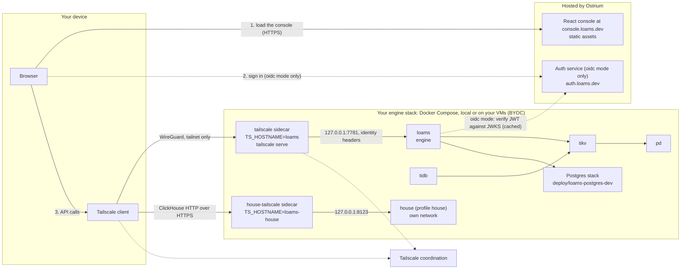

# Loams v0.1.0-preview.2: run the whole stack yourself

Status: **preview**, v0.1.0-preview.2 (the second preview; v0.1.0-preview.1 was published
2026-10-12). What changed since preview.1 is in [What is new in preview.2](#what-is-new-in-preview2)
and the [changelog](../../CHANGELOG.md). Everything listed as
**Preview** in the [README's feature table](../../README.md#features) ships in this release.
Preview means built, tested in CI and usable, but not production ready: APIs, on-disk formats,
flags and image layouts can still change without a migration path, and parts of the security
model are not hardened yet (see [Security model](#security-model)).

v0.1.0-preview.2 ships one path: **your own Tailscale tailnet plus our hosted console at
`https://console.loams.dev`**. You run the Loams stack; we host the console and, for the
optional `oidc` mode, the auth service.

| Piece | Who runs it | Where |
|---|---|---|
| The engine stack: `loams`, TiDB on TiKV and PD, the House, the Postgres stack | **You** | Docker Compose on your laptop, or on your own VMs (BYOC) with `deploy/release/byoc/install.sh` over SSH |
| The private network between your devices and the stack | **You** | Your own Tailscale tailnet |
| The React console (static files) | Ostrium | `https://console.loams.dev` |
| The auth service (OIDC issuer), only for `oidc` mode | Ostrium | `https://auth.loams.dev` |

The engine is never exposed on the public internet. Your browser reaches it over the tailnet,
through the Tailscale client on your own device.

**Coming soon, not in this release:** the console on your own Vercel or Cloudflare project,
self-service OIDC clients (`auth.loams.dev/register`), Headscale networks, one-click OAuth
deploy, and the House wired to the engine (and so to the console's House page).

## What is new in preview.2

- **Loams House on your tailnet** (`--profile house`): the House gets its own Tailscale
  sidecar and serves the ClickHouse HTTP interface at `https://loams-house.<tailnet>.ts.net`,
  with chDB's access control (R-ACL.1), the statement checks (L1) and the workers' OS sandbox
  (L3) all on. See [Loams House](#loams-house).
- **Loams Graph** recovers from crashes: a fenced single owner per graph, snapshots in the
  bucket and recovery, rehydration and idle eviction (GR1 Tasks 12 to 14), on Loams' Grafeo
  fork (`ostrium-labs/grafeo` v0.5.43-loams.1).
- **Loams Live** gains `LiveAdminService` (deploy, rollback, index status, function logs),
  schema validators and online index changes (LV1 Tasks 8 to 10).
- **Desktop and CLI on macOS and Windows:** see [Desktop and CLI](#desktop-and-cli).
- **SDKs from package registries:** see [SDKs](#sdks).

## Desktop and CLI

<!-- PLACEHOLDER(rel2-platforms): the desktop app and CLI binaries for macOS and Windows in
v0.1.0-preview.2 (downloads, signing status, install steps). Filled in through the release
controller; do not edit here. -->

_To be filled in before the tag: the desktop app and CLI for macOS and Windows._

## SDKs

<!-- PLACEHOLDER(rel2-sdks): which SDKs v0.1.0-preview.2 publishes to package registries, under
which names, and how to install them. Filled in through the release controller; do not edit
here. -->

_To be filled in before the tag: the SDKs published to package registries._

## Architecture



1. The browser loads the console's static files from `console.loams.dev`. The console holds
   no data and no secrets.
2. In the default `tailscale` mode there is no separate sign-in: the console calls your
   engine and Tailscale tells the engine who you are. In `oidc` mode the console signs you
   in with Authorization Code + PKCE against the auth service; tokens live in memory only,
   never in `localStorage`.
3. The console calls your engine at `LOAMS_ENGINE_URL`, a tailnet URL such as
   `https://loams.<tailnet>.ts.net`. The request leaves your browser through your device's
   Tailscale client and reaches the stack's `tailscale` sidecar. Off the tailnet the URL does
   not resolve and nothing answers.
4. In `oidc` mode the engine verifies the token against the issuer's JWKS (fetched outbound,
   cached). The auth service never connects to your stack, and never sees your data.

## What is in the stack

The compose file is [`deploy/release/compose.yaml`](../../deploy/release/compose.yaml), with
its settings in `deploy/release/.env.example`.

| Service | Image | Role |
|---|---|---|
| `pd` | PD | TiKV's placement driver |
| `tikv` | TiKV | Metadata, Live transactions, TiDB's storage |
| `tidb` | `ghcr.io/ostrium-labs/tidb:v8.5.8-loams.1` | Loams SQL (MySQL compatible) |
| `loams` | `ghcr.io/ostrium-labs/loams` | The engine, built with `live,live-tikv,durable,graph,tikv,pgwire,mysql-wire,stream-grpc` |
| `house` (profile `house`) | `ghcr.io/ostrium-labs/loams-fabric` | Loams House (the front, with `loams-house-worker` inside), on a network of its own. Not started by default; not wired to the engine yet (the engine answers `house_not_configured`) |
| `house-tailscale` (profile `house`) | `tailscale/tailscale` | The House's own door: joins the tailnet as `loams-house` and serves its ClickHouse HTTP interface there |
| Postgres stack | pinned in `deploy/pins/loams-postgres-images.toml` | Included from [`deploy/loams-postgres-dev`](../../deploy/loams-postgres-dev/README.md) |
| `console` (profile `console`, optional) | static console | A local copy of the console, for local trials; the supported console is the hosted one |
| `tailscale` | `tailscale/tailscale` | The stack's only door: joins the tailnet as `loams` and serves the engine there |
| `headscale` (profile `headscale`) | Headscale | Coming soon, unsupported in this release (see [the tailnet](#the-tailnet)) |

`ghcr.io/ostrium-labs/loams-agentd` (the agent daemon) is published too, and is optional.
Images are tagged `0.1.0-preview.2` and the rolling `:preview`, never `:latest`. The compose
file pins `0.1.0-preview.2` through `LOAMS_VERSION`. The patched TiDB image
`ghcr.io/ostrium-labs/tidb:v8.5.8-loams.1` is public and amd64 only.

Only the `tailscale` service (and, with `--profile house`, `house-tailscale`) is reachable
from outside the compose network, and only over your tailnet. Nothing binds `0.0.0.0` on the
host by default.

## Quick start: fully local

You need Docker with the Compose plugin (v2.20.3 or later, for `include`), several GB of free
memory (TiKV, TiDB and the Postgres stack are the large ones), and the Tailscale client on the
machine whose browser you will use.

```sh
git clone https://github.com/ostrium-labs/loams.git
cd loams/deploy/release
cp .env.example .env
```

Edit `.env`:

- `TS_AUTHKEY`: an auth key from your Tailscale admin console (Settings, Keys). A tagged,
  non-ephemeral, single-use key is the right shape; see [the tailnet](#the-tailnet).
- `TS_HOSTNAME=loams`: the stack's name on the tailnet. Keep it unless you run two stacks.
- `LOAMS_AUTH_MODE`: `tailscale` by default, which needs nothing more. Set
  `LOAMS_TAILSCALE_ALLOWED_USERS` to narrow who is admitted. See [Auth modes](#auth-modes).

Then start it:

```sh
docker compose up -d
docker compose ps                                   # every service running
docker compose exec tailscale tailscale status      # the stack is on your tailnet
```

The engine's URL is `https://<TS_HOSTNAME>.<tailnet>.ts.net`, by default
`https://loams.<tailnet>.ts.net`.

Enable **MagicDNS** and **HTTPS certificates** for your tailnet (Tailscale admin console, DNS),
so the sidecar can serve `https://loams.<tailnet>.ts.net`. Open
[console.loams.dev](https://console.loams.dev) in a browser on a device that is on the same
tailnet, and enter that URL as your engine.

From the CLI or an SDK, set `LOAMS_AUTH_MODE=apikey`, create a key with `loams auth new-key`
and use the same tailnet URL.

To stop, `docker compose down`. Your data stays in the compose volumes; `docker compose
down -v` deletes it.

### Without a tailnet

For a laptop-only trial with nothing on any network, set `LOAMS_AUTH_MODE=off` and use the
optional local `console` service. `off` is accepted only for loopback clients: the engine
refuses every request that does not come from loopback, so this mode cannot be reached over
the tailnet. Do not use it on a shared machine.

## BYOC: your own VM over SSH

The stack is the same on a VM: one VM for a trial, or the services split across VMs that share a
tailnet. The VM needs no inbound port other than SSH, and SSH itself can move onto the tailnet
once the stack is up.

From a checkout on your own machine, `deploy/release/byoc/install.sh` does it over SSH: it
installs Docker if missing, copies the compose bundle, writes `.env` (asking for your
Tailscale auth key) and starts the stack.

```sh
deploy/release/byoc/install.sh -i ~/.ssh/id_ed25519 you@your-vm
```

By default it starts `loams`, `tailscale` and `tidb`; `--all` starts every service,
the Postgres stack included, and `--version` picks the image tag (default `0.1.0-preview.2`).
Add the House with `--services "loams tailscale tidb house house-tailscale"`.
`byoc/uninstall.sh` removes it. To do it by hand instead, copy `deploy/release` to the VM,
`cp .env.example .env`, set `TS_AUTHKEY` and run `docker compose up -d`.

Your device then reaches the engine at `https://loams.<tailnet>.ts.net`, exactly as in the
local quick start. Nothing on the VM listens on its public address.

### The tailnet

**Tailscale.** Create an auth key in the admin console (Settings, Keys), tagged for example
`tag:loams`, and put it in `TS_AUTHKEY`. Add a policy rule that lets your own devices reach
`tag:loams` on port 443, and nothing else reach it. Leave `TS_LOGIN_SERVER` empty.

**Headscale: coming soon, unsupported in this release.** The `headscale` profile and
`TS_LOGIN_SERVER` exist in the compose file, but Headscale issues no `*.ts.net` HTTPS
certificates, so the hosted console (HTTPS) cannot call the engine through it: the browser
blocks it as mixed content. Use Tailscale for v0.1.0-preview.2.

## The console on your own Vercel or Cloudflare: coming soon

Hosting the console on your own Vercel or Cloudflare project is not part of v0.1.0-preview.2.
Use `https://console.loams.dev`. Likewise not in this release: self-service OIDC clients at
`auth.loams.dev/register` and one-click OAuth deploy.

## Loams House

`docker compose --profile house up -d` starts the House and its sidecar. Give the sidecar its own
auth key in `HOUSE_TS_AUTHKEY` (or leave it empty to reuse `TS_AUTHKEY`, which must then be
reusable); it joins the tailnet as `HOUSE_TS_HOSTNAME` (`loams-house`). Then, from a device on
the tailnet:

```sh
docker compose exec house cat /var/lib/loams-house/house.key    # the password, made on first start
curl -u "default:$PASSWORD" https://loams-house.<tailnet>.ts.net/ --data-binary 'SELECT version()'
```

Any ClickHouse HTTP client works the same way (port 443, TLS, user `default`). The House's
security layers in this preview:

- **chDB's access control first** (HS1 ruling R-ACL.1): the users workers run as have no
  `SOURCES` grants and a constrained settings profile, so table functions and engines that
  reach files, URLs or other databases are refused by ClickHouse itself; control DDL is
  checked against the same rules (R11.11). The test-only `open_acl` is refused outside a test
  build.
- **The statement checks (L1)** stay as a second line.
- **The workers' OS sandbox (L3)**, `HOUSE_SANDBOX`: `pods` (the default) applies Landlock
  (reads of the code, writes to the worker's own directory, TCP only to its read proxy; needs
  Linux 6.7 or later) and seccomp (no `execve`, no new processes, no namespaces, IP sockets
  only), and needs no privilege, so it works under Docker's and Podman's default container
  profiles, Docker Desktop included. `netns` adds a user and network namespace per worker with
  only a loopback; it needs unprivileged user namespaces inside the container, which Podman
  allows by default and Docker's default seccomp profile refuses. A worker whose sandbox cannot
  be put in force refuses to boot, and the House answers with an error rather than run it
  unsealed.
- **Its own network.** The `house` network has no other member, so the House cannot reach TiKV,
  TiDB, the engine or the Postgres stack, and none of them can reach it.

## Security model

**What protects the engine in this preview:**

- **Tailnet only.** The engine has no public address. Only the `tailscale` sidecar (and the
  House's `house-tailscale`, with `--profile house`) is reachable from outside the compose
  network, and only for tailnet members your tailnet policy allows. Nothing binds `0.0.0.0` on the host by default.
- **Authentication on every request**, chosen by `LOAMS_AUTH_MODE`.
- **The auth service never reaches your stack.** In `oidc` mode the engine fetches the
  issuer's JWKS outbound; the auth service sees sign-ins, not data.
- **No tokens in browser storage.** In `oidc` mode access tokens are kept in memory.

### Auth modes

| `LOAMS_AUTH_MODE` | Who it accepts | Settings |
|---|---|---|
| `tailscale` (default) | The Tailscale identity that `tailscale serve` adds. The engine trusts it only on the dedicated listener `LOAMS_TAILSCALE_LISTEN` (`127.0.0.1:7781`), which is the sidecar's serve target; every other listener ignores those headers, so a forged one on the main port gets a 401. Browser requests are limited by CORS to `https://console.loams.dev` (or `LOAMS_CORS_ORIGINS`) | `LOAMS_TAILSCALE_LISTEN`, `LOAMS_TAILSCALE_ALLOWED_USERS` (logins; empty admits every user your tailnet policy lets reach the node) |
| `oidc` | Bearer JWTs from the issuer (`https://auth.loams.dev` or your own), RS256 or EdDSA, verified against its JWKS (cached) | `LOAMS_OIDC_ISSUER`, `LOAMS_OIDC_AUDIENCE=loams-console`, and one of `LOAMS_OIDC_ALLOWED_EMAILS`, `_SUBJECTS` or `_GROUPS`: the engine refuses to start without one |
| `apikey` | API keys for the CLI and SDKs; the file holds only hashes. Create one with `loams auth new-key` | `LOAMS_API_KEYS_FILE` |
| `off` | Loopback clients only; every other client is refused | none |

The compose default is `tailscale`.

**What is not hardened yet:**

- **Authorization is coarse.** A valid token or key can do anything the engine can do; there
  are no per-namespace roles or tenant quotas yet (planned).
- **Keep the other listeners inside the stack.** The tailnet sidecar serves the engine's main
  port. The Qdrant, Elasticsearch, Flight SQL, Postgres-wire and MySQL-wire listeners, Resonate
  stay inside the compose network unless you publish them. The House's ClickHouse HTTP
  interface is served only through its own sidecar, with the House's own user and password. Do not publish them in this preview: the auth modes above are specified for the main
  port, and the other listeners are not all reviewed against them.
- **Traffic inside the compose network is plain text**, between `loams`, TiDB, TiKV, PD and
  the Postgres stack. The tailnet encrypts the hop from your device to the stack.
- **The Postgres development stack uses default credentials** and `fsync = off` in its
  compute spec (see its [README](../../deploy/loams-postgres-dev/README.md)).
- **No backups or upgrades are automated.** Back up the compose volumes yourself; a later
  preview may need a fresh stack.
- **No external security review** has been done.

Report anything you find through [SECURITY.md](../../SECURITY.md), not in a public issue.

## Known limitations

- **SDKs.** See [SDKs](#sdks) for what preview.2 publishes. <!-- PLACEHOLDER(rel2-sdks): replace
  with the SDK limitations of preview.2. --> In preview.1 every SDK was used from the repository
  (`sdks/<language>`), with TypeScript, Python, Go, Rust, C#, C++ and Swift tested in CI
  against a live server.

- **Loams Postgres:** the control plane can now provision computes and endpoints (PG2 Tasks
  10 to 12: the compose compute runtime, the endpoint lifecycle and idle suspend), but
  `pg-control` is not in the engine image: its compute runtime drives Docker, and the
  self-hosted stack does not hand the engine a container runtime. In this preview the Postgres
  stack runs Neon's storage and computes from `deploy/loams-postgres-dev`, and tenants,
  timelines and computes are created by hand as its README shows. Its images are pinned to Neon's last public build until the
  fork's own builds (NF1 Task 14).
- **Loams Graph:** writes reach the Loams log before they are acknowledged and graphs recover
  from snapshots and the log after a crash (GR1 Tasks 11 to 14). It is still a preview: keep a
  copy of graph data you cannot recreate.
- **Loams Live:** a change made on one node can take up to 60 seconds to reach live queries
  on another node (cross-node pickup). `LiveAdminService` (deploy, rollback, index status,
  logs) is served on the Live listener, which is loopback only in the compose stack and not
  forwarded over the tailnet. Documents, transactions, indexes and live queries work.
- **Loams House:** the engine does not reach it yet (its link needs TLS, HS1 Task 20), so
  `loams.house.v1` and the console's House page answer `house_not_configured`; use the House's
  own tailnet URL. Its user is a single generated local key until Task 20 brings Loams
  identities. `pods` mode needs Landlock with TCP rules (Linux 6.7 or later; Docker Desktop
  runs its own Linux kernel): on an older kernel the workers refuse to boot.
- **Console:** several pages (Jobs, Connectors, SQL, Git, Postgres control plane, Live
  deployments) still run against mocked clients and show demonstration data, not your stack.
  House and Analytics are not wired to the engine in this preview.
- **Durable on TiKV** is in progress: Loams Durable keeps its state in SQLite on the `loams`
  service's data.
- **Not in this release:** Loams Git (its storage core and repository catalog are built, but
  there is no push or fetch path yet), first-party connectors (built and tested, but no image
  hosts their runtime yet), Loams Jobs, the Loams SQL gate; Headscale networks; the console on
  your own Vercel or Cloudflare; self-service OIDC clients; one-click OAuth deploy.
- **Browsers on Chromium** may ask for permission the first time a page on a public origin
  calls an address on your tailnet (Local Network Access). Allow it for the console's origin.
- **No upgrade path between previews.** Formats can change; read the
  [changelog](../../CHANGELOG.md) before pulling a new `:preview`. Moving from preview.1, start
  a fresh stack (`docker compose down -v`, then `up -d` with `LOAMS_VERSION=0.1.0-preview.2`).

## Reporting issues

- **Bugs and rough edges:** open an issue at
  [github.com/ostrium-labs/loams/issues](https://github.com/ostrium-labs/loams/issues). Include
  the image tags (`docker compose images`), your `LOAMS_AUTH_MODE`, your Tailscale setup, and the output of `docker compose logs <service>` for the failing service.
  Remove tokens, API keys and `TS_AUTHKEY` from anything you paste.
- **Security issues:** privately, through [SECURITY.md](../../SECURITY.md).
- **Questions and ideas:** GitHub Discussions on the same repository.

## Related

- [Publishing](publishing.md): how the images reach `ghcr.io/ostrium-labs`.
- [Private networking (§43)](../design/43-private-networking.md) and
  [multi-tenant BYOC control plane (§41)](../design/41-multitenant-byoc-control-plane.md): where
  the managed BYOC path goes after the preview.
