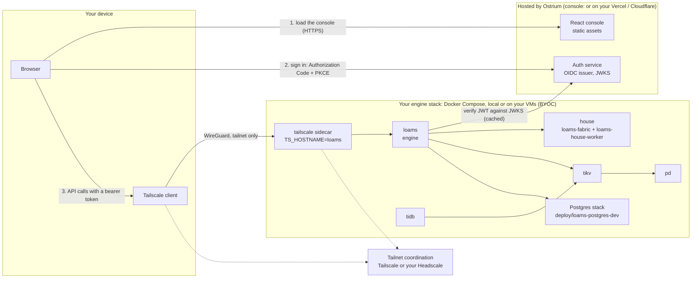

# Loams preview: run the whole stack yourself

Status: **preview**, first published 2026-10-12. Everything listed as **Preview** in the
[README's feature table](../../README.md#features) ships in this release. Preview means
built, tested in CI and usable, but not production ready: APIs, on-disk formats, flags and
image layouts can still change without a migration path, and parts of the security model are
not hardened yet (see [Security model](#security-model)).

You run the Loams stack. We host two small things, and you can replace both:

| Piece | Who runs it | Where |
|---|---|---|
| The engine stack: `loams`, the House, TiDB on TiKV and PD, the Postgres stack | **You** | Docker Compose on your laptop, or on your own VMs (BYOC) reached over SSH |
| The private network between your devices and the stack | **You** | A tailnet: Tailscale, or your own Headscale |
| The React console (static files) | Ostrium, or **you** | `https://console.loams.dev`, or your own Vercel or Cloudflare project, or the compose `console` service |
| The auth service (OIDC issuer) | Ostrium | `https://auth.loams.dev` (placeholder domain, configurable) |

The engine is never exposed on the public internet. Your browser reaches it over the tailnet,
through the Tailscale client on your own device.

## Architecture



1. The browser loads the console's static files from the hosted console (or your own copy).
   The console holds no data and no secrets.
2. The console signs you in with OIDC Authorization Code + PKCE against the auth service.
   Tokens live in memory only, never in `localStorage`; they are renewed through the auth
   service's httpOnly cookie or a silent renew.
3. The console calls your engine at `LOAMS_ENGINE_URL`, a tailnet URL such as
   `https://loams.<tailnet>.ts.net`. The request leaves your browser through your device's
   Tailscale client and reaches the stack's `tailscale` sidecar. Off the tailnet the URL does
   not resolve and nothing answers.
4. The engine verifies the token against the issuer's JWKS (fetched outbound, cached). The
   auth service never connects to your stack, and never sees your data.

## What is in the stack

The compose file is [`deploy/release/compose.yaml`](../../deploy/release/compose.yaml), with
its settings in `deploy/release/.env.example`.

| Service | Image | Role |
|---|---|---|
| `pd` | PD | TiKV's placement driver |
| `tikv` | TiKV | Metadata, Live transactions, TiDB's storage |
| `tidb` | `ghcr.io/ostrium-labs/tidb:v8.5.8-loams.1` | Loams SQL (MySQL compatible) |
| `loams` | `ghcr.io/ostrium-labs/loams` | The engine, built with `live,live-tikv,durable,graph,tikv,pgwire,mysql-wire,stream-grpc` |
| `house` | `ghcr.io/ostrium-labs/loams-fabric` | Loams House (the front, with `loams-house-worker` inside) |
| Postgres stack | pinned in `deploy/pins/loams-postgres-images.toml` | Included from [`deploy/loams-postgres-dev`](../../deploy/loams-postgres-dev/README.md) |
| `console` (optional) | static console | A local copy of the console, for when you do not want the hosted one |
| `tailscale` | `tailscale/tailscale` | The stack's only door: joins the tailnet as `loams` and serves the engine there |
| `headscale` (profile `headscale`) | Headscale | Your own tailnet coordination server, instead of Tailscale's |

`ghcr.io/ostrium-labs/loams-agentd` (the agent daemon) is published too, and is optional.
Every Loams image is tagged `:<version>` and `:preview`; pin `:<version>` if you want a
stack that does not move under you.

Only the `tailscale` service is reachable from outside the compose network. Nothing binds
`0.0.0.0` on the host by default.

## Quick start: fully local

You need Docker with the Compose plugin (v2.20 or later, for `include`), several GB of free
memory (TiKV, TiDB and the Postgres stack are the large ones), and the Tailscale client on the
machine whose browser you will use.

```sh
git clone https://github.com/ostrium-labs/loams.git
cd loams/deploy/release
cp .env.example .env
```

Edit `.env`:

- `TS_AUTHKEY`: an auth key from your Tailscale admin console (Settings, Keys). A tagged,
  non-ephemeral, single-use key is the right shape; see [the tailnet](#the-tailnet).
- `TS_HOSTNAME=loams`: the stack's name on the tailnet. Keep it unless you run two stacks.
- `LOAMS_AUTH_MODE`: `oidc` by default, with `LOAMS_OIDC_ISSUER=https://auth.loams.dev`
  and `LOAMS_OIDC_AUDIENCE`. API keys for the CLI and SDKs are on as well, from
  `LOAMS_API_KEYS_FILE`. See [Auth modes](#auth-modes).

Then start it:

```sh
docker compose up -d
docker compose ps                                   # every service running
docker compose exec tailscale tailscale status      # the stack is on your tailnet
```

The engine's URL is `https://<TS_HOSTNAME>.<tailnet>.ts.net`, by default
`https://loams.<tailnet>.ts.net`.

Enable **MagicDNS** and **HTTPS certificates** for your tailnet (Tailscale admin console, DNS),
so the sidecar can serve `https://loams.<tailnet>.ts.net`. Open
[console.loams.dev](https://console.loams.dev), sign in, and enter that URL as your engine.

From the CLI or an SDK, use the same tailnet URL with an API key from
`LOAMS_API_KEYS_FILE`.

To stop, `docker compose down`. Your data stays in the compose volumes; `docker compose
down -v` deletes it.

### Without a tailnet

For a laptop-only trial with nothing on any network, set `LOAMS_AUTH_MODE=off` and use the
optional local `console` service. `off` is accepted only for loopback clients: the engine
refuses every request that does not come from loopback, so this mode cannot be reached over
the tailnet. Do not use it on a shared machine.

## BYOC: your own VM over SSH

The stack is the same on a VM: one VM for a trial, or the services split across VMs that share a
tailnet. The VM needs no inbound port other than SSH, and SSH itself can move onto the tailnet
once the stack is up.

```sh
ssh you@your-vm
# Docker Engine and the Compose plugin, from your distribution or docs.docker.com
git clone https://github.com/ostrium-labs/loams.git
cd loams/deploy/release
cp .env.example .env
$EDITOR .env                # TS_AUTHKEY, and TS_LOGIN_SERVER for Headscale
docker compose up -d
docker compose ps
```

Your device then reaches the engine at `https://loams.<tailnet>.ts.net`, exactly as in the
local quick start. Nothing on the VM listens on its public address.

### The tailnet

**Tailscale.** Create an auth key in the admin console (Settings, Keys), tagged for example
`tag:loams`, and put it in `TS_AUTHKEY`. Add a policy rule that lets your own devices reach
`tag:loams` on port 443, and nothing else reach it. Leave `TS_LOGIN_SERVER` empty.

**Headscale.** Start the stack with the `headscale` profile, or point at a Headscale you
already run:

```sh
docker compose --profile headscale up -d headscale
docker compose exec headscale headscale users create loams
docker compose exec headscale headscale users list            # note the user's ID
docker compose exec headscale headscale preauthkeys create --user <ID> --expiration 1h
```

Put the key in `TS_AUTHKEY`, set `TS_LOGIN_SERVER` to your Headscale's URL, and start the rest
with `docker compose --profile headscale up -d`. On your own device:
`tailscale up --login-server <your Headscale URL>`.

Two things are different with Headscale:

- **Headscale has to be reachable by every device that joins**, so it is the one component
  you put behind a public HTTPS name (a reverse proxy with a certificate, or a small VM of its
  own). It holds no Loams data.
- **Headscale does not issue `*.ts.net` certificates**, so the sidecar cannot serve the engine
  over HTTPS by itself. A console loaded over HTTPS (the hosted one, or yours on Vercel or
  Cloudflare) cannot call a plain-HTTP engine: the browser blocks it as mixed content. Use the
  local `console` service over the tailnet, or terminate TLS for the engine's tailnet name with
  a certificate of your own.

## The console on your own Vercel or Cloudflare

The console is static files with a small runtime config, so you can host it yourself and
still use our auth service, or your own OIDC issuer. Its runtime config is:

| Variable | Value |
|---|---|
| `LOAMS_ENGINE_URL` | Your engine's tailnet URL, e.g. `https://loams.<tailnet>.ts.net` |
| `LOAMS_AUTH_ISSUER` | `https://auth.loams.dev`, or your own OIDC issuer |
| `LOAMS_AUTH_CLIENT_ID` | The OIDC client registered for your console's origin |

The values are written into `config.json` when the build is staged, and read by the console at
run time; nothing is baked into the bundle. Your console's origin must be a registered
redirect URI of `LOAMS_AUTH_CLIENT_ID`, and the engine must accept the issuer and audience in
the tokens it receives.

**Cloudflare (Workers static assets).** From a checkout:

```sh
pnpm install --frozen-lockfile
cd web
pnpm build
LOAMS_ENGINE_URL=https://loams.<tailnet>.ts.net \
LOAMS_AUTH_ISSUER=https://auth.loams.dev \
LOAMS_AUTH_CLIENT_ID=<client id> \
  node apps/console/deploy/stage.mjs
cd apps/console
# edit wrangler.jsonc: your Worker name and route instead of console.loams.dev
npx wrangler deploy
```

Staging writes `dist-cloudflare/` with the console under `/ui/`, a Content-Security-Policy
that allows fetches only to the console itself and the configured engine, security headers
(`_headers`) and the `/` to `/ui/` redirect (`_redirects`).

**Vercel.** Import the repository and set:

- Root directory: the repository root. Install command: `pnpm install --frozen-lockfile`.
- Build command: `cd web && pnpm build && node apps/console/deploy/stage.mjs`.
- Output directory: `web/apps/console/dist-cloudflare`.
- Environment variables: `LOAMS_ENGINE_URL`, `LOAMS_AUTH_ISSUER`, `LOAMS_AUTH_CLIENT_ID`.

Vercel does not read `_headers` or `_redirects`. Add a `vercel.json` at the project's root
directory (here the repository root) with the redirect and the single-page fallback:

```json
{
  "redirects": [{ "source": "/", "destination": "/ui/", "permanent": false }],
  "rewrites": [{ "source": "/ui/:path*", "destination": "/ui/index.html" }]
}
```

The CSP is a `<meta>` tag in the staged HTML, so it applies on Vercel too; the other security
headers from `_headers` do not unless you copy them into `vercel.json`.

Whichever host you use, it only serves files. API calls still go from the browser straight to
your engine over the tailnet.

## Security model

**What protects the engine in this preview:**

- **Tailnet only.** The engine has no public address. Only the `tailscale` sidecar is
  reachable from outside the compose network, and only for tailnet members your tailnet
  policy allows. Nothing binds `0.0.0.0` on the host by default.
- **Authentication on every request**, chosen by `LOAMS_AUTH_MODE`.
- **The auth service never reaches your stack.** The engine fetches the issuer's JWKS
  outbound; the auth service sees sign-ins, not data.
- **No tokens in browser storage.** Access tokens are kept in memory; renewal uses the auth
  service's httpOnly cookie or a silent renew.

### Auth modes

| `LOAMS_AUTH_MODE` | Who it accepts | Settings |
|---|---|---|
| `oidc` | Bearer JWTs from the issuer, RS256 or EdDSA, verified against the issuer's JWKS (cached) with the expected audience | `LOAMS_OIDC_ISSUER`, `LOAMS_OIDC_AUDIENCE` |
| `apikey` | API keys for the CLI and SDKs; the file holds only hashes of the keys | `LOAMS_API_KEYS_FILE` |
| `off` | Loopback clients only; every other client is refused | none |

The default compose configuration is `oidc` with the issuer `https://auth.loams.dev`, plus
API keys for the CLI and SDKs.

**What is not hardened yet:**

- **Authorization is coarse.** A valid token or key can do anything the engine can do; there
  are no per-namespace roles or tenant quotas yet (planned).
- **Keep the other listeners inside the stack.** The tailnet sidecar serves the engine's main
  port. The Qdrant, Elasticsearch, Flight SQL, Postgres-wire and MySQL-wire listeners, Resonate
  and the House's ClickHouse HTTP interface stay inside the compose network unless you publish
  them. Do not publish them in this preview: the auth modes below are specified for the main
  port, and the other listeners are not all reviewed against them.
- **Traffic inside the compose network is plain text**, between `loams`, the House, TiDB, TiKV,
  PD and the Postgres stack. The tailnet encrypts the hop from your device to the stack.
- **The Postgres development stack uses default credentials** and `fsync = off` in its
  compute spec (see its [README](../../deploy/loams-postgres-dev/README.md)).
- **No backups or upgrades are automated.** Back up the compose volumes yourself; a later
  preview may need a fresh stack.
- **No external security review** has been done.

Report anything you find through [SECURITY.md](../../SECURITY.md), not in a public issue.

## Known limitations

- **Loams Postgres:** the control plane is partial. Its library (projects, branches, roles,
  databases, the reconcilers and the Neon upcall API; PG2 Tasks 1 to 8) is merged, but it is not
  wired into the `loams` binary yet (PG2 Task 9). In this preview the Postgres stack runs Neon's
  storage and computes from `deploy/loams-postgres-dev`, and tenants, timelines and computes are
  created by hand as its README shows. Its images are pinned to Neon's last public build until
  the fork's own builds (NF1 Task 14).
- **Loams Graph:** not crash-safe yet. Writes are acknowledged only after their change set
  reaches the Loams log (GR1 Task 11,
  [#424](https://github.com/ostrium-labs/loams/pull/424)), but rebuilding a graph from the log
  after a crash (GR1 Task 14) and the kill-matrix fault gate (Task 16) are not done. Keep a
  copy of graph data you cannot recreate.
- **Loams Live:** the deploy flow (versioned deployments with compare-and-swap activation) is in
  progress ([#419](https://github.com/ostrium-labs/loams/pull/419)). Documents, transactions,
  indexes and live queries work.
- **Loams House:** over the ClickHouse HTTP interface, a result larger than one engine block
  (about 65 000 rows) in a format with a header or footer (JSON, CSVWithNames, Parquet, Arrow)
  comes back malformed (HS1 ruling R8.4); the fix is pending. The `loams.house.v1` API, which the
  console uses, is not affected.
- **Console:** several pages (House, Jobs, Connectors, SQL, Postgres control plane, Live
  deployments) still run against mocked clients and show demonstration data, not your stack.
- **Durable on TiKV** is in progress: Loams Durable keeps its state in SQLite on the `loams`
  service's data.
- **Headscale and HTTPS:** see [the tailnet](#the-tailnet). The hosted console needs an HTTPS
  engine URL.
- **Browsers on Chromium** may ask for permission the first time a page on a public origin
  calls an address on your tailnet (Local Network Access). Allow it for the console's origin.
- **No upgrade path between previews.** Formats can change; read the
  [changelog](../../CHANGELOG.md) before pulling a new `:preview`.

## Reporting issues

- **Bugs and rough edges:** open an issue at
  [github.com/ostrium-labs/loams/issues](https://github.com/ostrium-labs/loams/issues). Include
  the image tags (`docker compose images`), your `LOAMS_AUTH_MODE`, whether you use Tailscale
  or Headscale, and the output of `docker compose logs <service>` for the failing service.
  Remove tokens, API keys and `TS_AUTHKEY` from anything you paste.
- **Security issues:** privately, through [SECURITY.md](../../SECURITY.md).
- **Questions and ideas:** GitHub Discussions on the same repository.

## Related

- [Publishing](publishing.md): how the images reach `ghcr.io/ostrium-labs`.
- [Private networking (§43)](../design/43-private-networking.md) and
  [multi-tenant BYOC control plane (§41)](../design/41-multitenant-byoc-control-plane.md): where
  the managed BYOC path goes after the preview.
